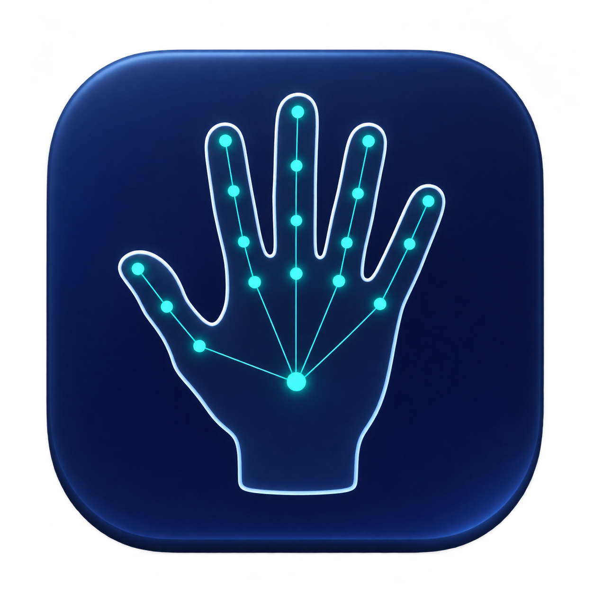

# AirControl AI

<p align="center"></p>

**Touchless Computer Controller for macOS.** Use your built-in camera to move the cursor, click, drag, navigate slides, control media, type on a virtual keyboard, or draw in the air.

MediaPipe and OpenCV run locally. AirControl opens in simulation, where you can practice while watching the webcam overlay, virtual cursor and activity feed. Live input requires an explicit confirmation, macOS Accessibility permission and a registered emergency shortcut.

## Install and run

Use native arm64 Python 3.12 on Apple Silicon macOS. The installer downloads dependencies and the official [Hand Landmarker model](https://developers.google.com/edge/mediapipe/solutions/vision/hand_landmarker?tab=Python). After installation, AirControl can run offline.

```bash
./scripts/install.sh
./scripts/launch.sh
```

If Python 3.12 is installed outside PATH, run the installer with AIRCONTROL_PYTHON set to its executable. In VS Code, open this folder, select .venv/bin/python as the interpreter, and use the included launch configuration.

1. Select **Start camera** and grant Camera permission.
2. Point near the center of the preview for about a second to calibrate. Practice gestures in **Simulation**.
3. Select **Enable live control** when you are ready. Allow Accessibility access and confirm.
4. Press **Control–Option–Command–Escape** to stop sending input and return to simulation.

See the [gesture guide](docs/GESTURES.md), [user guide](docs/USER_GUIDE.md), and [macOS packaging guide](docs/PACKAGING.md).

## Modes

| Mode | Controls |
|---|---|
| Pointer | Motion, click, right click, double click, scroll and drag |
| Media | Play/pause and volume |
| Shortcuts | Last-app switching and a saved keyboard combination |
| Keyboard | Gesture-operated keyboard with local composition and optional focused-app output |
| Drawing | In-app pen canvas driven by pinch and motion |
| Presentation | Next and previous slide in the focused presentation |

Settings include gesture-to-action bindings, preferred hand, smoothing, sensitivity, cooldown and recalibration. Camera frames stay in memory. Activity is session-local.

## Development

```bash
.venv/bin/python -m unittest discover -s tests -v
```

The tests exercise recognition using synthetic landmarks for both hands, timing and arming, hand loss, drag release, mode routing, bindings and the permission gate. The camera process owns OpenCV and MediaPipe. A supervisor thread publishes the latest frame so the UI does not accumulate a frame backlog. The gesture engine is independent of Qt and macOS. The native input adapter centralizes Quartz events and the emergency hotkey.

The source is released under the [MIT license](LICENSE). MediaPipe, the downloaded model, OpenCV, PySide6 and PyObjC are third-party components distributed under their own license terms.
